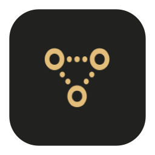

<p align="center">
  
</p>

<h1 align="center">Seamless</h1>
<p align="center"><a href="https://github.com/diamachi/seamless/actions/workflows/build.yml"></a></p>
<p align="center">Bring your Android phone into your Mac workflow.</p>
<p align="center"><a href="#features">Features</a> · <a href="#try-it">Try it</a> · <a href="#permissions">Permissions</a> · <a href="#build-from-source">Build</a> · <a href="docs/ARCHITECTURE.md">Architecture</a></p>

Files, notifications, clipboard, phone screen and live camera, together in a native Mac app and Android companion. Pair your devices over your local network, select a phone, and keep the controls within reach from the window or menu bar.

**Development preview.** A free public preview is available; production distribution is still in development. Some integrations are experimental; the [validation record](docs/VALIDATION.md) separates device-tested behavior from remaining work. GitHub Actions builds test installers; there is no automatic updater yet.

## Features

### Files and photos

- Send files in either direction, or drop them into the Mac window or menu bar.
- Select multiple files on Android; send a selected folder as a ZIP with its structure preserved.
- Browse authorized phone storage and a resizable photo/video grid. Save selected items or folder trees to your Mac.
- Receive into Downloads by default, with unique names for duplicates and per-phone automatic receiving settings.
- Follow progress inside the app and receive completion/failure notifications. File data streams through encrypted connections and is SHA-256 checked; large-file resume is still planned.

### Notifications and clipboard

- Choose which Android apps can relay notifications to the Mac. Supported alerts offer reply or dismiss actions.
- Send text and links between devices, use Android's Share menu, and keep an optional in-memory clipboard shelf.
- Enable automatic Mac-to-phone text sharing. Android restricts unattended background clipboard access, so phone-to-Mac sharing requires a supported foreground/share action.

### Phone screen and camera

- Mirror your phone inside the Mac app or pop it into a separate window, with optional Accessibility-based control.
- Request 60 fps or experimental 120 fps profiles. Device, network and workload determine actual performance.
- Use optional ADB/scrcpy integration for direct single-app windows and USB transport. USB debugging must remain enabled for that mode.
- Stream the phone camera with supported quality/frame-rate controls. An experimental OBS virtual-camera bridge has been tested in local preview and browser camera selection; it requires the OBS driver. A standalone native camera extension is not shipped.

### A home for your devices

- Save several phones, rename them, switch the active device, and keep settings separate.
- See battery, processor, Android version, RAM and storage information. The companion can show its connected Mac's hardware summary.
- Ring a connected phone, review setup permissions, and reconnect without pairing again.
- Light, dark and system appearance, with subtle native translucency and a compact menu-bar dashboard. Closing the main window leaves the menu bar connected; Open app restores the window. Quit Seamless exits completely.

**Experimental calls:** Bluetooth call controls and input/output selectors exist. HFP control connection has been tested; real call audio, SCO routing, mute and tones have not passed live-call validation. Do not rely on this preview for calling.

## Try it

Download the [0.6.10 preview from GitHub Releases](https://github.com/diamachi/seamless/releases/tag/v0.6.10), or get CI packages from **Actions → Build test installers → a successful run → Artifacts**. See [CI setup and signing limits](docs/CI.md). Local build outputs are placed in `dist/`:

| Platform | Package | Install |
| --- | --- | --- |
| macOS | `Seamless_<version>.dmg` | Open the image and drag Seamless into Applications. |
| Android | `Seamless_<version>.apk` | Open the APK on Android and review the installation prompt. |

Local DMGs are ad-hoc signed test packages, **not notarized releases**. Android 0.6.12 onward uses stable distribution signing on main; PR/debug builds remain development-signed. Moving from older debug APKs may require one final reinstall. See [signing and backup notes](docs/DEVELOPMENT_SIGNING.md). Preview installers are published through GitHub Releases. No Homebrew package or automatic updater is configured. macOS package minimum is 14; Android minimum is 7.0/API 24, with feature-specific gates. These build minimums do not establish physical compatibility across all versions. Initial physical tests use Android 17 and macOS 27.

## macOS installation — unnotarized preview

Open the DMG and drag Seamless into Applications. This preview is not notarized. If macOS blocks the downloaded app and you trust this release, run:

```sh
xattr -dr com.apple.quarantine /Applications/Seamless.app
```

This removes the downloaded-file quarantine attribute from Seamless and its contents. It does not notarize the app or change system-wide Gatekeeper settings. Run it only for the copy you intentionally installed from this repository.

### Pair once

The QR flow requires macOS and Android companion 0.6.10 or newer (available from GitHub Releases). Older releases use the full-code method.

1. Connect both devices to the same reachable local network and open Seamless.
2. On the Mac, choose Connect new phone → Create pairing QR.
3. On Android, choose Pair a Mac → Scan Mac QR code. Scan the Mac screen, then approve the named Mac on Android. The full-code method remains available under Use full code instead.
4. Review the optional permissions for the features you want. Select notification apps explicitly.

Saved credentials handle later connections. Android's connection service can run in the background with a persistent system notification; battery restrictions, force-stop and reboot can affect it. The Android Reconnect button asks a running, reachable paired Mac to reconnect. Normal Wi-Fi features do not require debugging. Android screen-sharing consent is still required for each normal capture session.

## Your data

Seamless's continuity connection operates directly between paired devices, without a cloud account or hosted relay. Invitations expire, connections pin the phone's certificate, and credentials are stored through macOS Keychain and Android Keystore-backed storage. Discovery locates devices; it cannot establish trust.

Notifications, files and clipboard text are sent only through the selected/authenticated feature paths. Clipboard history is optional and held in memory. Received files remain in the chosen destination. Broad phone storage access is optional; a selected folder or selected media can be used instead. Private app storage is not exposed by that grant.

Do not publish pairing codes, credentials, device logs, build caches or local settings. See [development signing](docs/DEVELOPMENT_SIGNING.md) before distributing your own build.

## Permissions

Setup explains the relevant grants and can be revisited from Settings. Declining a feature permission leaves that feature unavailable.

| Permission or setup | Purpose |
| --- | --- |
| Android notification access | Read and relay notifications from selected apps. |
| Notifications on each device | Display incoming alerts and transfer results. |
| Android Accessibility, optional | Control the phone during an approved screen session. |
| Android screen capture | Authorize each normal screen-sharing session. |
| Android camera | Scan the Mac pairing QR or capture an explicitly requested live-camera session. |
| Android selected files/folders or All files access | Share and browse the authorized storage scope. |
| Android battery exemption, optional | Reduce background-service interruptions. |
| Mac Bluetooth and microphone, optional | Experimental call controls and audio routing. |
| OBS camera extension, optional | Make the experimental phone-camera output available to other apps. |
| USB debugging, optional | ADB USB transport and direct single-app mirroring. |

## Build from source

macOS: Swift 6 and a compatible macOS SDK. Android: JDK 21, Android SDK platform 36 and build tools 35.0.0. Set `ANDROID_HOME` to your SDK location. Gradle dependencies require network access on the first build.

```sh
python3 scripts/check-source-privacy.py
sh scripts/test-macos.sh
sh scripts/build-macos.sh
sh scripts/package-macos.sh
sh scripts/build-android.sh
```

```sh
cd android
./gradlew :app:assembleDebug :app:testDebugUnitTest :app:lintDebug
```

The Android APK is generated at `android/app/build/outputs/apk/debug/app-debug.apk`. Mac builds use `SEAMLESS_SIGNING_IDENTITY` or an ignored local signing configuration when provided; otherwise they use ad-hoc signing. The packaging script creates a separate ad-hoc-signed copy for the test DMG.

## Project map

```text
macos/Sources/SeamlessApp/    Native Mac UI, connections and feature coordinators
macos/Sources/SeamlessCore/   Protocol values, policies and persistence models
macos/Tests/                 Core and app regression tests
android/app/src/main/        Android companion UI, services and device integrations
scripts/                     Build, package, icon and test tooling
docs/                        Architecture, feature constraints and validation
```

UI observes feature state; connection and platform services own the behavior. Contributions should use descriptive names, small functions and readable branches, and update the architecture when responsibilities or behavior change. See [AGENTS.md](AGENTS.md).

## Documentation

- [Architecture and entry points](docs/ARCHITECTURE.md)
- [Development plan](docs/DEVELOPMENT_PLAN.md)
- [Physical validation and limitations](docs/VALIDATION.md)
- [Onboarding](docs/ONBOARDING.md)
- [File sharing](docs/FILE_SHARING.md)
- [Advanced USB and app mirroring](docs/ADVANCED_CONNECTIONS.md)
- [Calling setup](docs/CALLING_SETUP.md)

A source license has not been selected in this workspace. Public release licensing, distribution signing and notarization remain release tasks.
